# The Polson factory: ticket to main

How one ticket becomes a commit on `main`, as the repo works on 2026-11-23. Every node is checked against `.github/workflows/polson-agent.yml`, the scripts in `.github/polson/`, `AGENTS.md` and the `protect-main` ruleset. Nothing here is aspirational unless it is marked PLANNED.

**Status marks**

- **USED**: it has happened on a real ticket. The issue, PR or run number is the proof.
- **BUILT**: it is in the workflow or scripts, but no real run has needed it yet.
- **PLANNED**: it is not built.

## Diagram

```mermaid
flowchart TD
  T["Ticket: GitHub issue with acceptance criteria<br/>USED: #23"]
  INV["Investigate: a person runs Qodo Codebase Wisdom<br/>USED: #16"]
  RT{"A person routes it: does the work<br/>need edits under .github/?<br/>USED: #16 split into #17 agent, #18 person"}
  T --> INV --> RT

  subgraph PERSON["Person path: interactive Claude Code"]
    P1["Implement, uncommitted<br/>USED: PR #20"]
    P2["Qodo local review of staged and unstaged changes<br/>USED: PR #20"]
    P3{"Valid High or Medium?"}
    P4["Commit, push, open the PR<br/>USED: PR #20"]
    PW["Wait for CI and Qodo's review of the head commit,<br/>apply the quality gate by hand<br/>USED: PR #20, PR #24"]
    P1 --> P2 --> P3
    P3 -- "yes: fix" --> P1
    P3 -- "no" --> P4 --> PW
  end
  RT -- "yes" --> P1

  subgraph START["Agent run start: polson-agent.yml, one job at a time"]
    L["A person adds ready-for-agent<br/>USED: #23"]
    NT["Nightly 01:17 UTC, 02:17 Lagos:<br/>oldest open ready-for-agent issue<br/>trigger USED: run 45000874965, nothing to pick"]
    WD["Manual run: workflow_dispatch<br/>BUILT"]
    SW["Hand over issues an earlier run left in agent-working<br/>BUILT"]
    CK{"Issue open and still<br/>labelled ready-for-agent?"}
    MK["Swap to agent-working, clear an old<br/>needs-human or agent-done<br/>USED: #23"]
    L --> SW
    NT --> SW
    WD --> SW
    SW --> CK
    CK -- "yes" --> MK
  end
  RT -- "no" --> L
  CK -- "no" --> NOP["Nothing to do, no label change<br/>USED: run 45000874965"]

  RC{"Resume check: open PRs from<br/>branches named issue-slug?"}
  MK --> RC
  B["Build agent: implement, typecheck, tests,<br/>push-branch.sh, PR with Closes # and the criteria<br/>USED: #17 PR #19, #23 PR #24"]
  AB{"After build: agent step succeeded<br/>and exactly one agent PR exists?<br/>USED: #23"}
  RC -- "none<br/>USED: #23" --> B --> AB

  CI["Required CI on every push: Node 24, Node 20.19.0<br/>USED: every PR"]
  WT["Scripted wait, wait-for-pr.sh: every 60 s, up to 15 min.<br/>CI finished on the head commit, Qodo's review names it,<br/>the fail-closed reader gives a number, no busy comment,<br/>2 polls agree. USED: #23 PR #24; grouped findings: #39 PR #40"]
  RC -- "one agent PR: resume<br/>USED: #9 PR #11" --> WT
  AB -- "yes" --> WT
  CI -.-> WT
  CI -.-> PW

  WG{"Wait gate: PR open,<br/>CI and Qodo finished?"}
  WT --> WG
  RS["Resolve agent, applies the quality gate:<br/>fix valid High or Medium, disagree with evidence,<br/>list Low, push at most once, Round report<br/>USED: #9 round 1, #17 rounds 1 and 2"]
  WG -- "yes, before round 1 or 2" --> RS
  AR{"After resolve: did it push?"}
  RS --> AR
  AR -- "yes: wait again<br/>USED: #17 2a7009c" --> WT
  AR -- "no<br/>USED: #9, #17" --> FN
  WG -- "yes, after round 2<br/>BUILT" --> FN

  FN{"Finish: PR head unchanged, CI green,<br/>Qodo finished, 0 open High or Medium?"}
  CD["candidate-done: issue, PR and head SHA<br/>as agent job outputs. USED: run 45239806352, #39"]
  QR["qodo-record job, fresh runner, no PR code,<br/>read-only token: reads Qodo's review record<br/>for the head. USED: run 45239806352, #39"]
  VQ{"verify-qodo job, no Qodo key: still agent-working,<br/>head unchanged, and the record shows a complete,<br/>non-skipped review of it? USED: run 45239806352 #39 agent-done,<br/>run 45156397208 #29 needs-human"}
  HJ["hand-over job, always last: verification<br/>did not start or finish. BUILT, #26"]
  AD["agent-done, with a summary comment<br/>USED: #9, #17, set by the agent job before #26;<br/>#39, set by verify-qodo"]
  NH["needs-human: comment first, then label<br/>USED: #9, #23"]
  FN -- "yes" --> CD --> QR --> VQ
  VQ -- "yes" --> AD
  VQ -- "no: comment, then label" --> NH
  HJ --> NH
  FN -- "no<br/>BUILT" --> NH
  WG -- "no: not finished in 15 min, unreadable review,<br/>PR not open, branch moved<br/>USED: #9, #23" --> NH
  RC -- "a PR not opened by the agent,<br/>or more than one<br/>BUILT, tested in find-pr.test.ts" --> NH
  AB -- "no<br/>BUILT" --> NH
  AGE["The agent escalates itself: unclear criteria,<br/>needs .github/, cannot fix within the rules<br/>BUILT"] --> NH
  HO["A step fails or times out: hand-over step<br/>BUILT"] --> NH

  subgraph HUMAN["A person decides"]
    HD["Review the PR against the quality gate.<br/>Dismiss a finding in Qodo: USED PR #12, an accepted risk.<br/>Accept an exception in writing: USED PR #12, PR #21.<br/>Take over an escalated ticket: USED #23 PR #24.<br/>Relabel to retry: USED #9."]
  end
  AD --> HD
  NH --> HD
  PW --> HD
  HD -- "relabel" --> L

  QW["Qodo workflow 'Polson gate: no Medium+ findings':<br/>no finding of Medium or higher in all 9 categories<br/>on the reviewed commit, so it adds the 'Qodo approved' label.<br/>USED: PR #46, labelled at 08:09:11Z by qodo-code-review[bot]<br/>on 8a59478 (complete review, no open finding);<br/>no label on 8894d11 while a Medium was open"]
  QG{"Approval guard: does the PR change .github/**?<br/>USED: PR #45 (.github/polson/, clean review of f718662)<br/>got no label; the guard decision is not shown in the portal"}
  QW --> QG
  QG -- "no: label added" --> HD
  QG -- "yes: no label, a person must approve" --> HD
  SEP["Still checked separately, never by the label:<br/>required CI (typecheck, tests), acceptance criteria,<br/>every Low listed, the review covers the head (qodo-record)"]
  SEP --> HD

  MG["A person merges with gh pr merge.<br/>protect-main: a PR and both CI checks,<br/>no force push or deletion, no bypass<br/>USED: PR #11, PR #19, PR #24"]
  HD -- "gate met" --> MG --> MAIN["main"]

  subgraph SEC["Security scan lane (Arnica, Day 16)"]
    MIR["Mirror polson-factory/polson, an exact copy of main<br/>Actions disabled<br/>USED: first sync 24 Nov 2026, 3516570"]
    ARN["Arnica scan: SCA, License, SAST<br/>scan-only: no PR blocking, no comments, no repo writes<br/>USED: first scan 24 Nov 2026 on 3516570"]
    TR["Owner triages each finding (rule 4: prove it first)<br/>USED: 14 Medium findings"]
    FX["Fix through an owner PR<br/>USED: PR #50"]
    SG["CI + Qodo gate on the fix<br/>USED: PR #50"]
  end
  MAIN -- "owner syncs, manual" --> MIR --> ARN --> TR --> FX --> SG --> MAIN

  INVA["Codebase Wisdom inside the agent run<br/>PLANNED"]
  LRA["Qodo local review inside the agent run<br/>PLANNED"]
  NR["Night record and morning report from each run<br/>PLANNED: code in src/, not run by the workflow"]
  INVA -.-> B
  LRA -.-> B
  AD -.-> NR
  NH -.-> NR

  classDef used fill:#d8f0dc,stroke:#2e7d32,color:#111
  classDef built fill:#fff4cc,stroke:#b58900,color:#111
  classDef planned fill:#eeeeee,stroke:#888,stroke-dasharray:4 3,color:#444
  class T,INV,RT,P1,P2,P4,PW,L,NT,MK,NOP,B,AB,CI,WT,RS,AD,NH,HD,MG,CD,QR,VQ,SEP used
  class WD,SW,AGE,HO,HJ built
  class INVA,LRA,NR planned
  class QW,QG used
  class MIR,ARN,TR,FX,SG used
```

## Gates

Each gate says what must pass, the evidence it uses, what happens on failure, and who decides.

### 1. Routing

| | |
|---|---|
| Must pass | The issue has acceptance criteria. Work that needs `.github/` edits goes to a person, not the agent. |
| Evidence | The issue text, read by a person. Nothing checks this automatically. |
| On failure | The build or resolve agent escalates when it finds it needs `.github/` (its prompt says so, and `Edit(./.github/**)` and `Write(./.github/**)` are denied). |
| Who decides | A person, when writing and labelling the ticket. |

### 2. Start of a run

| | |
|---|---|
| Must pass | The label was added by a user, not a bot. The issue is open, is not a PR, and still has `ready-for-agent`. No other agent job is running. |
| Evidence | The event, then a fresh read of the issue (`polson-agent.yml`, "Resolve the issue number"). |
| On failure | "Nothing to do"; no label changes. A queued run replaced by a newer one never starts, so its issue keeps `ready-for-agent` for the nightly run. |
| Who decides | The workflow. |

### 3. Resume check and after build (`phase.sh find-pr`, `after-build`)

| | |
|---|---|
| Must pass | Resume check: 0 open PRs from `<issue>-*` branches means build; exactly 1, opened by the agent, means resume. After build: the agent step succeeded and exactly 1 agent PR exists. |
| Evidence | `gh pr list`, counted in jq. A count that can't be read fails the step (`test/find-pr.test.ts`). |
| On failure | `needs-human` for more than one PR, a PR not opened by the agent, no PR after the build, or a failed or skipped agent step. An unreadable list fails the step, and the hand-over step labels the issue. |
| Who decides | The script. |

### 4. Required CI (`ci.yml`)

| | |
|---|---|
| Must pass | `Node 24` and `Node 20.19.0` (`npm ci`, `npm run typecheck`, `npm test`) on the head commit. |
| Evidence | Check runs from the GitHub Actions app (id 15368) only. A same-named check from another app does not count. |
| On failure | Red CI goes to the resolve agent. CI not finished in 15 minutes, or red at finish, means `needs-human`. GitHub refuses the merge. |
| Who decides | The script during the run; the `protect-main` ruleset at merge. |

### 5. Scripted wait (`wait-for-pr.sh`, `qodo-open-findings.sh`)

| | |
|---|---|
| Must pass | All of these on 2 polls in a row with the same count: CI finished on the head commit; Qodo's "Code Review by Qodo" names the head commit; the reader prints a number; no "busy" comment. The reader prints a number only when the comment has Qodo's footer, every open finding has a known severity label (a badge labels the next finding; a "View <severity> (N)" header labels the N findings in its group, and a group with more or fewer is unknown, #41), and the count badges match the findings listed. Structure is matched only at the start of a line. |
| Evidence | Qodo's review comment and the check runs. |
| On failure | Unknown or unreadable counts as not finished. After 15 minutes: `needs-human`. The branch moving after the check also means `needs-human`. |
| Who decides | The script. |

### 6. Resolve (`resolve-prompt.md`, the AGENTS.md quality gate)

| | |
|---|---|
| Must pass | Each CI failure and Qodo finding is reproduced or traced first. Valid High and Medium findings are fixed. Disagreements are answered on the PR with evidence and flagged. Every Low is listed. Typecheck and tests pass. At most one push. Only verified criteria are ticked. There is a "Round N report" on the issue. |
| Evidence | The agent's report, its PR comments, the diff. |
| On failure | The agent escalates (`needs-human`). A round with no push goes straight to finish. After 2 pushed rounds, a last wait, then finish. |
| Who decides | The agent decides what is valid. A person accepts or rejects its disagreements. |

### 7. Finish (`phase.sh finish`)

| | |
|---|---|
| Must pass | The PR is open with the same head commit that was checked, CI succeeded, Qodo finished, and the open High or Medium count in Qodo's comment is the number 0. |
| Evidence | The latest wait's outputs and a fresh read of the PR. |
| On failure | `needs-human`, with the reason in a comment posted before the label. |
| Who decides | The script. Passing gives candidate-done (issue, PR and head SHA as job outputs), not `agent-done`: Qodo's comment cannot tell a skipped review from a real one (#26). |

### 7b. Verify Qodo's review (`qodo-record` and `verify-qodo` jobs)

| | |
|---|---|
| Must pass | The PR is still open with the head the agent job checked, and Qodo's review record says its latest run is on that head, completed, `review_complete` true, and `review_effort` not `skip`. |
| Evidence | Qodo's review record (`qodo read pr-review-session findings --extended`, by `qodo-record.sh`, up to 5 reads a minute apart, after it fetches the CLI's tool catalog and checks the command is in it, #37), then a fresh read of the issue's labels and the PR, right before writing (`verify-qodo.sh`). |
| On failure | Anything else is not reviewed: a skip ("Qodo skipped reviewing <head>"), a run still going, an older commit, no review, a CLI error, unreadable output, or a changed head. Comment, then `needs-human`. A ticket a person has taken in the meantime is left alone. If either job fails or never starts, the `hand-over` job hands the ticket over. |
| Who decides | The scripts, on fresh runners with no PR code (only `.github/polson` from the default branch). `qodo-record` is the only job with `QODO_API_KEY`; its token can only read contents, and the installer and CLI run with an environment allowlist. `verify-qodo` can write issues but never runs Qodo's code. |

### 8. Human review and merge

| | |
|---|---|
| Must pass | The quality gate's "done": no valid High or Medium open, typecheck and tests pass, the latest Qodo review covers the final code, every Low listed. A disagreed finding is dismissed in Qodo, and an exception is accepted in writing on the PR. |
| The Qodo approved label | An input, not the decision. It says only that Qodo's workflow criteria were met on the commit it reviewed (gate 8a). It does not show that CI passed, that the tests or the acceptance criteria hold, that every Low is listed, or that the review covers the current head. Those are checked as before. |
| Evidence | The PR, Qodo's review, CI, and the agent's report or the person's notes. |
| On failure | No merge. The person relabels to retry, takes the ticket over, or closes it. |
| Who decides | A person. |

### 8a. Qodo workflow and approval guard (Qodo, Day 14)

| | |
|---|---|
| Must pass | Qodo's workflow "Polson gate: no Medium+ findings": the review has no finding of Medium or higher in any of its 9 categories, so Qodo adds the "Qodo approved" label. The approval guard (repository shrooms08/polson, path `.github/**`) means a PR that changes `.github/**` gets no label from the workflow, however clean the review: a person approves it. |
| Evidence | The PR's labels (`gh pr view --json labels`) and Qodo's review. The workflow's own activity is in Qodo's portal (PR Triage). The Qodo CLI has no tool that reads workflow activity, so from the command line only the label itself shows a result. The portal does not show the guard's decision either (PR #45): for a guarded PR, the evidence is a clean review and no label. |
| On failure | No label. Nothing else changes: gates 4 to 8 still decide. |
| Who decides | Qodo's workflow for the label; a person for anything under `.github/**` and for every merge. |

### 9. `protect-main` ruleset

| | |
|---|---|
| Must pass | A pull request, plus `Node 24` and `Node 20.19.0` from GitHub Actions. No force push, no branch deletion, no bypass actors. |
| Evidence | GitHub. |
| On failure | GitHub refuses the push or merge. |
| Who decides | GitHub, as configured by the owner. It does not check Qodo, approvals (0 required), or whether the branch is up to date with `main`. |

## Security scan (Arnica, Day 16)

- **Why a mirror:** Arnica supports organisation-owned repositories only. `polson-factory/polson` is an exact mirror of `main`, pushed by the owner by hand, with GitHub Actions disabled so the push runs no workflow.
- **First scan** (24 Nov 2026, on `3516570`): 14 findings, all Medium.
  - **12 License:** `lightningcss@1.33.0` and its platform binaries, MPL-2.0. Dev-only: `vitest` → `vite` → `lightningcss`; `npm ls lightningcss --omit=dev` is empty. Dismissed: the risk is tolerable.
  - **2 SAST, "Excessive workflow permission assignment"** in `.github/workflows/polson-agent.yml`. The workflow-level `permissions:` block applied only to the `agent` job; the other three jobs declare their own.
- **Line 60, `contents: write`: valid.** The workflow token never wrote contents or pull requests; the agent pushes and opens PRs with the Claude GitHub App token from claude-code-action's OIDC exchange. Fixed in PR #50: the `agent` job's token is now `contents: read` and `pull-requests: read` (with `issues: write`, `id-token: write`, `actions: read`, `checks: read`), and the workflow level is `permissions: {}`. Proven by run 45364906717: the agent pushed its branch and opened PR #52 with the Claude App token (author `app/claude`), and no step got a 403.
- **Line 68, `id-token: write`: required** for the action's OIDC exchange; without it the action cannot authenticate. Dismissed: risk accepted.

## Status of every step

| Step | Status | Proof |
|---|---|---|
| Ticket with acceptance criteria | USED | #23 |
| Investigate with Codebase Wisdom (person) | USED | #16 ([comment](https://github.com/shrooms08/polson/issues/16#issuecomment-7078340522)) |
| Route by `.github/` need (person) | USED | #16 split into #17 (agent) and #18 (person) |
| Person path: uncommitted, local Qodo review, fix, commit, PR | USED | PR #20 (#18) |
| Person waits for CI and Qodo, applies the gate by hand | USED | PR #20, PR #24 |
| `ready-for-agent` added by a person | USED | #9, #17, #23 |
| Nightly trigger | USED, but no ticket picked yet | run 45000874965 (scheduled 01:17 UTC, started 08:01 UTC): "Nothing to do" |
| Manual run (`workflow_dispatch`) | BUILT | |
| Hand over issues left in `agent-working` | BUILT | Ran every time, never found one |
| Swap to `agent-working`, clear old outcome labels | USED | #23 |
| Resume check: none, so build | USED | #17, #23 |
| Resume check: one agent PR, so resume | USED | #9 (PR #11, run 45001404177) |
| Resume check: foreign or duplicate PR, so `needs-human` | BUILT | `test/find-pr.test.ts` |
| Build agent and `push-branch.sh` | USED | #17 (PR #19), #23 (PR #24) |
| After build: no PR or a failed agent step, so `needs-human` | BUILT | |
| Required CI | USED | Every PR |
| Scripted wait | USED | #9, #17, #23 |
| Wait gate: not finished, so `needs-human` | USED | #9 ([comment](https://github.com/shrooms08/polson/issues/9#issuecomment-7070095037)), #23 ([comment](https://github.com/shrooms08/polson/issues/23#issuecomment-7084443687)) |
| Resolve round 1 | USED | #9, #17 |
| Resolve round 1 pushed, so wait again | USED | #17 (`2a7009c`) |
| Resolve round 2 | USED | #17 |
| Resolve pushed nothing, so finish | USED | #9, #17 |
| Last wait after round 2 | BUILT | |
| Agent escalates itself | BUILT | Only in the pre-PR #12 workflow (#9, run 44910962909) |
| Finish: `agent-done` (set by the agent job, before #26) | USED | #9, #17 |
| Finish: candidate-done, then `qodo-record` and `verify-qodo` set `agent-done` or `needs-human` | USED | `agent-done`: #39 (PR #40, run 45239806352: `run=complete effort=lite`, "Reviewed: agent-done."). `needs-human`: #29 (run 45156397208, record unreadable before #37) |
| Findings reader: several findings in one "View <severity> (N)" group | USED | #39 (PR #40's three Low findings read as 0 in run 45239806352; fixed by #41, PR #42) |
| `hand-over` job after verification did not finish | BUILT | #26 (`test/hand-over.test.ts`) |
| Finish: `needs-human` (CI red, High or Medium left, unreadable, PR changed) | BUILT | |
| Hand-over step after a failed or timed-out step | BUILT | Ran every time, never needed |
| Dismiss a finding in Qodo | USED | PR #12: a High accepted as a risk (#13) |
| Accept a disagreement by dismissing it in Qodo (the quality gate's way) | BUILT (a rule, not yet used) | Not used yet. PR #20's disagreed Medium was merged before the gate existed and is still pending in Qodo. |
| Accept an exception in writing | USED | PR #12 (a Medium, the 150-minute job limit), PR #21 ([comment](https://github.com/shrooms08/polson/pull/21#issuecomment-7084182389)) |
| Take over an escalated ticket | USED | #23 (PR #24) |
| Relabel to retry | USED | #9 |
| Merge by a person through `protect-main` | USED | PR #11, PR #19, PR #24 |
| Codebase Wisdom inside the agent run | PLANNED | |
| Qodo local review inside the agent run | PLANNED | |
| Qodo workflow adds "Qodo approved" when no Medium+ finding | USED | PR #46 (#44, outside the guard): no label on 8894d11 while a Medium was open; after the fix, `Qodo approved` added by `qodo-code-review[bot]` at 08:09:11Z on 8a59478 (complete lite review, Medium implemented, Low outdated). No PR review or approval came with it. |
| Approval guard: `.github/**` changes get no label, a person approves | USED | PR #45 (#36, `.github/polson/`): complete standard review of f718662 with no open findings, and no label, while the same workflow labelled PR #46. The guard's decision itself is not visible in Qodo's portal (PR Triage) or the CLI, so the evidence is the label's absence. |
| Security scan lane: mirror, Arnica scan, owner triage, fix through an owner PR | USED | First scan 24 Nov 2026 on `3516570`: 14 Medium findings; the valid SAST finding fixed in PR #50, proven by run 45364906717 |
| Night record and morning report from each run | PLANNED | `src/night-record.ts` and `src/morning-report.ts` exist; no workflow step writes a record |

## Walkthrough: issue #23

[#23](https://github.com/shrooms08/polson/issues/23), "Test the Qodo findings reader on real Qodo comments".

1. **Ticket.** A person wrote it on 2026-11-22 with four acceptance criteria and "must not edit anything under .github/".
2. **Route: agent.** A person added `ready-for-agent` at 19:13:03Z.
3. **Start.** [Run 45059495279](https://github.com/shrooms08/polson/actions/runs/45059495279): no left-behind issues. At 19:13:31Z the label went from `ready-for-agent` to `agent-working`.
4. **Resume check.** No open PR, so build.
5. **Build agent.** It committed `ecced4d` (three fixtures, 10 tests) and opened [PR #24](https://github.com/shrooms08/polson/pull/24) at 19:15:15Z with `Closes #23` and the criteria. It said it could not prove its tests fail first, because the script is under `.github/`.
6. **After build.** One agent PR, so wait.
7. **Required CI** on `ecced4d`: [run 45059698651](https://github.com/shrooms08/polson/actions/runs/45059698651), green on both Node versions.
8. **Qodo** reviewed `ecced4d` at 19:17:11Z (lite effort): 2 Medium findings.
9. **Scripted wait.** 15 polls, 19:15 to 19:29. From poll 3 the review named the head commit, but the reader printed `unknown` every time: it took text Qodo had quoted inside a finding for real structure.
10. **Wait gate: `needs-human`.** [Escalation comment](https://github.com/shrooms08/polson/issues/23#issuecomment-7084443687): "Qodo did not finish reviewing ecced4d within 15 minutes". The resolve agent never ran.
11. **A person steps in: diagnosis.** Read-only, nothing posted. Qodo had finished; the reader misread it.
12. **A person steps in: fix.** [`c012d32`](https://github.com/shrooms08/polson/commit/c012d32dd221e3ceea7d80ea77c6d9f05afcf3d5). The reader matches structure only at line start, requires the footer, and treats an unlabelled finding as `unknown`. Seven new tests failed on the old script and pass on the new one. Also closes #22. Replies on finding [1](https://github.com/shrooms08/polson/pull/24#issuecomment-7086699602) and [2](https://github.com/shrooms08/polson/pull/24#issuecomment-7086700276).
13. **Required CI** on `c012d32`: [run 45076742789](https://github.com/shrooms08/polson/actions/runs/45076742789), green.
14. **Qodo** reviewed `c012d32` (standard effort): finding 2 resolved, finding 1 still open.
15. **A person runs the wait script read-only:** `qodo=finished open_high_medium=1`. The reader now gives a number.
16. **A person applies the gate.** Finding 1 does not reproduce on `c012d32`, so the person did not change code. Fix round 1, [`d3fd88b`](https://github.com/shrooms08/polson/commit/d3fd88bfb60e920e93de72d8500b57a7b347e7ab), adds a test that cuts each fixture at every line before the footer, with [evidence on the PR](https://github.com/shrooms08/polson/pull/24#issuecomment-7086791018).
17. **Required CI** on `d3fd88b`: [run 45077518880](https://github.com/shrooms08/polson/actions/runs/45077518880), green. **Qodo** (lite effort): both findings resolved, no Low. The wait script gave `qodo=finished open_high_medium=0`.
18. **Merge by a person.** `31a4d1c` at 22:28:03Z through `protect-main`. Main's CI: [run 45077877944](https://github.com/shrooms08/polson/actions/runs/45077877944), green. #23 and #22 closed. On 2026-11-23 a person removed the leftover `needs-human` label.

**Verification that was missing on #23**

- The person path skipped the Qodo local review before pushing `c012d32` and `d3fd88b`. Only the PR reviews checked the person's code.
- The fixed reader has only run read-only, from a person's checkout. The unattended workflow has not yet used it on a ticket.
- There is no "Round report" on #23. The person's gate work is recorded on PR #24, not in the agent's report format.
- The `resolve-prompt.md:31` change (unknown label means unknown) has no test, and no run has used it yet.
- #22 closed with its "No script change" criterion unticked; the PR flagged it for a person.
- The final Qodo review of `d3fd88b` was lite. The standard-effort review covered `c012d32`; `d3fd88b` only added a test.
- Local tests ran on macOS awk. Linux awk was covered only by CI.

## Gaps

1. **Qodo is not required at merge.** `protect-main` requires a PR and both CI checks, with 0 approvals. Nothing on GitHub stops a merge with open High or Medium findings or no Qodo review. That gate is a person's discipline.
2. **"Never merges" is enforced by tool rules only.** The workflow comment says only the ruleset can enforce it against the agent's token. But the ruleset needs only a PR and green CI, so code the agent runs (for example `npm test`) holds a token that could merge a green PR. #13 covers a related risk: code pushed to agent branches runs with that token.
3. **`.github/` is now partly enforced in code, still not by GitHub.** `push-branch.sh`, the agents' only way to push, refuses a branch whose changes against the default branch add, change, delete or rename anything under `.github/`, and names the paths (BUILT, `test/push-branch.test.ts`). That matters since the builder may run `git rm` and `git mv`. The helper runs git without the repository's hooks, the agents' file tools are denied `.git/` and the runner's temp directory, and the trusted copy of the scripts there is owned by root and read-only, so the file tools cannot change the guard (PR #33, Qodo: "Builder can push protected files"). It does not stop code the agent runs from using its token directly, and routing tickets is still a person's judgement. The protected path on GitHub is PLANNED (Day 14).
4. **The night record and morning report are not wired in.** Polson's promise ends in "the human reads a morning report", but no run writes a night record.
5. **The nightly run is late and unproven.** Its one run started at 08:01 UTC instead of 01:17 (GitHub delays scheduled runs) and found nothing to do.
6. **Many failure paths have never run for real.** These are BUILT only:
   - the hand-over step and the left-behind sweep;
   - the last wait after round 2;
   - every `needs-human` reason at finish;
   - the agent escalating itself under the current prompts;
   - `workflow_dispatch`.

   Only the resume-check escalations have tests.
7. **"Every Low listed" is not checked.** Finish counts only High and Medium. Listing Lows relies on the resolve agent's report and the person's review.
8. **Required checks don't need an up-to-date branch.** The strict policy is off, so CI may have run against an older `main`.
9. **The person path has no scripted gate.** A person waits and applies the gate by hand; on PR #24 that meant running `wait-for-pr.sh` read-only.
10. **A skipped Qodo review read as clean. USED: fixed in code by #26 (PR #27), first used for real in run 45239806352.** On PR #25 Qodo's review record showed `review_effort: "skip"` and `review_complete: false` on all three runs, while its comment said "Great, no issues found!" for the head commit, and `wait-for-pr.sh` reported `qodo=finished open_high_medium=0`. Now the agent job ends with candidate-done. The `qodo-record` job reads Qodo's review record on a fresh runner, and the `verify-qodo` job decides: a skip goes to a person ("Qodo skipped reviewing <head>"). `QODO_API_KEY` never reaches the runner where agent-written code ran. Qodo's code never shares a runner with a GitHub write token: its job's token can only read contents, and the CLI's environment allowlist strips GitHub tokens. The first unattended run (run 45156397208, issue #29) could not read the record at all: Qodo CLI 2.4.0 builds `read pr-review-session findings` only from its cached tool catalog, which a fresh `QODO_HOME` with an API key never gets, so it rejected `--pr-url` and the ticket went to a person (failed closed). `qodo-record.sh` now runs `qodo tools --refresh` first and checks the command's contract before reading (#37). Run 45239806352 (issue #39, PR #40) then read the record in CI (`attempt 1 18:36:40: head=a1bb381 run=complete effort=lite`), and `verify-qodo` set `agent-done`. A skipped review has not come up in a real run yet: that branch is covered by `test/qodo-record.test.ts` and `test/verify-qodo.test.ts`.
11. **Two merged PRs still have open Medium findings in Qodo.** PR #12 ("Builder job now allowed 150 minutes", accepted in writing) and PR #20 ("Agent may have edited .github files", disagreed with evidence) were both merged before the quality gate existed and never dismissed. Qodo still lists both as pending.
12. **`review_complete=false` can stick on a PR; such PRs escalate to a person by design.** In Qodo's record for PRs #1 to #27, 4 of 31 non-skip runs had it, all on PR #20 and PR #27, and once a PR had it every later run did too. `verify-qodo` treats it as not reviewed (rule 6, and Qodo's guidance requires `review_complete=true`).
13. **Agent transcripts are kept only on failure or escalation, as summaries.** BUILT, not yet run for real. After each agent step, `keep-transcript.sh` keeps what the agent did: its text, its tool calls, failed or refused calls (cut to 300 characters), and the final result with its refused calls. It drops tool output, because the repository is public and any signed-in GitHub user can download its artifacts, and then redacts known credential formats. The agent job uploads the summaries (7-day retention) whenever the run ends without candidate-done. A step cut off at its time limit gets a partial summary from Claude Code's own session log, because the action writes its transcript only when the session ends. Not covered: a run that reached candidate-done and was then escalated by `verify-qodo`, since the agent job ends before that decision. Error text can still quote command output, and redaction only knows common formats.
14. **Qodo's "⊘ Outdated" mark made a clean review unreadable. FIXED by #47 (PR #48).** On PR #46 (8a59478) Qodo listed a resolved Medium and an outdated Low under "Resolved findings". `qodo-open-findings.sh` knew only Resolved and Dismissed, so `wait-for-pr.sh` printed `open_high_medium=unknown` on 25 polls while Qodo's record showed nothing open. Outdated now closes a finding in the resolved section only; any other mark there, or Outdated elsewhere, is still unknown (rule 6).
15. **The mirror sync is manual, so the scan can lag `main`.** The owner pushes `main` to `polson-factory/polson` by hand; findings describe the commit last pushed, not necessarily the current `main`.
16. **Arnica is not a merge gate.** It is scan-only by choice: no PR blocking, no comments, no repository writes. A finding reaches `main` only if the owner triages it and fixes it through a PR.
17. **Open: is `ACTIONS_ID_TOKEN_REQUEST_TOKEN` reachable by agent-run code?** The `agent` job needs `id-token: write`, so every step can request OIDC tokens, including code the agent writes and runs under `npm test`. Not yet checked whether claude-code-action removes it from the agent's environment.
18. **The agent's tool allowlist has no way to run a single test file.** Run 45364906717 escalated #51: the agent's `npx vitest` calls were refused, so it could not measure the test or reproduce Qodo's findings on PR #52.
